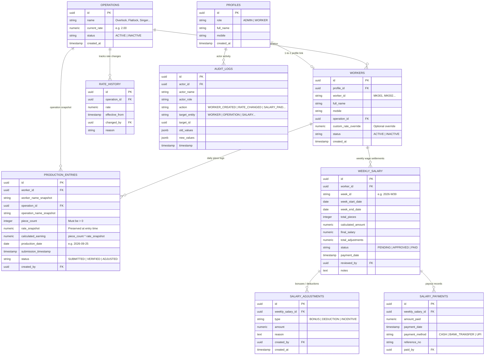

# Database Architecture & Schema Specification — MK APPREALS

**Database Engine**: PostgreSQL 15+ (Supabase compatible)  
**Encoding**: UTF-8  
**Row Level Security**: Fully Enforced  

---

## 1. Entity-Relationship Diagram (ERD)



---

## 2. Table Definitions & Constraints

### 2.1. `profiles`
- `id` UUID PRIMARY KEY DEFAULT gen_random_uuid() (References `auth.users.id` in Supabase)
- `role` TEXT NOT NULL CHECK (role IN ('ADMIN', 'WORKER'))
- `full_name` TEXT NOT NULL
- `mobile` TEXT UNIQUE
- `created_at` TIMESTAMPTZ DEFAULT NOW()

### 2.2. `operations`
- `id` UUID PRIMARY KEY DEFAULT gen_random_uuid()
- `name` TEXT NOT NULL UNIQUE
- `current_rate` NUMERIC(10, 2) NOT NULL CHECK (current_rate >= 0)
- `status` TEXT NOT NULL DEFAULT 'ACTIVE' CHECK (status IN ('ACTIVE', 'INACTIVE'))
- `created_at` TIMESTAMPTZ DEFAULT NOW()

### 2.3. `workers`
- `id` UUID PRIMARY KEY DEFAULT gen_random_uuid()
- `profile_id` UUID REFERENCES profiles(id) ON DELETE CASCADE
- `worker_id` TEXT NOT NULL UNIQUE CHECK (worker_id ~ '^[A-Z0-9_-]+$')
- `full_name` TEXT NOT NULL
- `mobile` TEXT NOT NULL
- `operation_id` UUID NOT NULL REFERENCES operations(id)
- `custom_rate_override` NUMERIC(10, 2) CHECK (custom_rate_override IS NULL OR custom_rate_override >= 0)
- `status` TEXT NOT NULL DEFAULT 'ACTIVE' CHECK (status IN ('ACTIVE', 'INACTIVE'))
- `created_at` TIMESTAMPTZ DEFAULT NOW()

### 2.4. `rate_history`
- `id` UUID PRIMARY KEY DEFAULT gen_random_uuid()
- `operation_id` UUID NOT NULL REFERENCES operations(id) ON DELETE CASCADE
- `rate` NUMERIC(10, 2) NOT NULL CHECK (rate >= 0)
- `effective_from` TIMESTAMPTZ NOT NULL DEFAULT NOW()
- `changed_by` UUID REFERENCES profiles(id)
- `reason` TEXT

### 2.5. `production_entries`
- `id` UUID PRIMARY KEY DEFAULT gen_random_uuid()
- `worker_id` UUID NOT NULL REFERENCES workers(id) ON DELETE RESTRICT
- `worker_name_snapshot` TEXT NOT NULL
- `operation_id` UUID NOT NULL REFERENCES operations(id)
- `operation_name_snapshot` TEXT NOT NULL
- `piece_count` INTEGER NOT NULL CHECK (piece_count > 0 AND piece_count <= 25000)
- `rate_snapshot` NUMERIC(10, 2) NOT NULL CHECK (rate_snapshot >= 0)
- `calculated_earning` NUMERIC(10, 2) NOT NULL GENERATED ALWAYS AS (ROUND(piece_count * rate_snapshot, 2)) STORED
- `production_date` DATE NOT NULL
- `submission_timestamp` TIMESTAMPTZ NOT NULL DEFAULT NOW()
- `status` TEXT NOT NULL DEFAULT 'SUBMITTED' CHECK (status IN ('SUBMITTED', 'VERIFIED', 'ADJUSTED'))
- `created_by` UUID REFERENCES profiles(id)
- *Constraint*: `CHECK (piece_count > 0)`

### 2.6. `weekly_salary`
- `id` UUID PRIMARY KEY DEFAULT gen_random_uuid()
- `worker_id` UUID NOT NULL REFERENCES workers(id) ON DELETE RESTRICT
- `week_id` TEXT NOT NULL -- Format: YYYY-Www (e.g. 2026-W39)
- `week_start_date` DATE NOT NULL
- `week_end_date` DATE NOT NULL
- `total_pieces` INTEGER NOT NULL DEFAULT 0 CHECK (total_pieces >= 0)
- `calculated_amount` NUMERIC(10, 2) NOT NULL DEFAULT 0.00 CHECK (calculated_amount >= 0)
- `final_salary` NUMERIC(10, 2) NOT NULL DEFAULT 0.00 CHECK (final_salary >= 0)
- `total_adjustments` NUMERIC(10, 2) NOT NULL DEFAULT 0.00
- `status` TEXT NOT NULL DEFAULT 'PENDING' CHECK (status IN ('PENDING', 'APPROVED', 'PAID'))
- `payment_date` TIMESTAMPTZ
- `reviewed_by` UUID REFERENCES profiles(id)
- `notes` TEXT
- *Constraint*: `UNIQUE(worker_id, week_id)`

### 2.7. `salary_adjustments`
- `id` UUID PRIMARY KEY DEFAULT gen_random_uuid()
- `weekly_salary_id` UUID NOT NULL REFERENCES weekly_salary(id) ON DELETE CASCADE
- `type` TEXT NOT NULL CHECK (type IN ('BONUS', 'DEDUCTION', 'INCENTIVE', 'CORRECTION'))
- `amount` NUMERIC(10, 2) NOT NULL
- `reason` TEXT NOT NULL
- `created_by` UUID REFERENCES profiles(id)
- `created_at` TIMESTAMPTZ DEFAULT NOW()

### 2.8. `audit_logs`
- `id` UUID PRIMARY KEY DEFAULT gen_random_uuid()
- `actor_id` UUID REFERENCES profiles(id)
- `actor_name` TEXT NOT NULL
- `actor_role` TEXT NOT NULL
- `action` TEXT NOT NULL
- `target_entity` TEXT NOT NULL
- `target_id` TEXT
- `old_values` JSONB
- `new_values` JSONB
- `timestamp` TIMESTAMPTZ NOT NULL DEFAULT NOW()

---

## 3. Database Indexes for High Performance
```sql
CREATE INDEX idx_production_worker_date ON production_entries(worker_id, production_date DESC);
CREATE INDEX idx_production_operation_date ON production_entries(operation_id, production_date DESC);
CREATE INDEX idx_production_date_range ON production_entries(production_date DESC);
CREATE INDEX idx_weekly_salary_worker_week ON weekly_salary(worker_id, week_id);
CREATE INDEX idx_weekly_salary_status ON weekly_salary(status);
CREATE INDEX idx_weekly_salary_date_range ON weekly_salary(week_start_date, week_end_date);
CREATE INDEX idx_audit_logs_timestamp ON audit_logs(timestamp DESC);
CREATE INDEX idx_workers_worker_id ON workers(worker_id);
```
